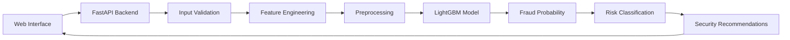

# 🛡️ Sentinel Risk Radar — AI-Powered Credit Card Fraud Detection

[](https://www.python.org/)
[](https://fastapi.tiangolo.com/)
[](https://lightgbm.readthedocs.io/)
[](https://www.docker.com/)
[](https://mlflow.org/)
[](LICENSE)

**Sentinel Risk Radar** is a full-stack Machine Learning application designed to assess credit card transaction risk and identify potentially fraudulent activity. It combines LightGBM, FastAPI, and Docker to provide real-time predictions through an interactive web interface and REST API.

<text></text>

## 🌐 Live Application

**Production Deployment:** https://sentinel-risk-radar.onrender.com

**API Documentation:** https://sentinel-risk-radar.onrender.com/docs

**GitHub Repository:** https://github.com/TechieManya/Pred_creditcard

---

## 📌 Project Overview

Credit card fraud detection is a challenging classification problem involving transaction patterns, unusual spending behaviour, and suspicious digital activity.

Sentinel Risk Radar provides an automated transaction risk assessment system with:

- **Transaction Analysis:** Evaluates 24 transaction-related input attributes.
- **Feature Engineering:** Derives additional features to capture transaction behaviour and potential risk indicators.
- **Machine Learning:** Uses a LightGBM classification model to estimate fraud probability.
- **Risk Classification:** Categorizes transactions into three risk levels:
  - 🟢 **LOW RISK:** Below 30%
  - 🟡 **MEDIUM RISK:** 30%–70%
  - 🔴 **HIGH RISK:** Above 70%
- **Security Recommendations:** Provides actionable suggestions based on detected risk indicators.

---

## 🏗️ System Architecture



---

## 🔬 Machine Learning Pipeline

### 1. Input Features

The application processes transaction attributes covering:

- Transaction amount and frequency
- Account balance and card information
- Merchant category and risk score
- Transaction location and time
- Authentication method
- Device and channel information
- VPN usage and geographic mismatches
- Other suspicious transaction indicators

### 2. Feature Engineering

Additional features are derived to capture behavioural patterns, transaction velocity, spending-to-balance relationships, and combined risk indicators.

### 3. Model Training and Evaluation

**Primary Algorithm:** LightGBM Classifier

The project uses a classification pipeline with preprocessing, feature engineering, and model evaluation.

| Evaluation Metric | Result |
|---|---:|
| Accuracy | 92.90% |
| Precision | 98.65% |
| Recall | 66.53% |
| F1-Score | 0.7946 |
| Training ROC-AUC | 0.9789 |
| Cross-Validation ROC-AUC | 0.7585 ± 0.0094 |

---

## 📊 Dataset 

The project is on credit card transaction fraud detection concepts.

**Dataset** [Kaggle – Credit Card Fraud Detection](https://www.kaggle.com/datasets/mlg-ulb/creditcardfraud)

---

## 🛠️ Technology Stack

| Component | Technology |
|---|---|
| Programming Language | Python 3.11 |
| Machine Learning | LightGBM, Scikit-learn |
| Backend Framework | FastAPI |
| Data Processing | Pandas, NumPy |
| Model Persistence | Joblib |
| Experiment Tracking | MLflow |
| Containerization | Docker |
| Frontend | HTML, CSS, JavaScript |
| Deployment | Render |
| Testing | Pytest |
| Version Control | Git, GitHub |

---

## 📂 Project Structure

```text
Pred_creditcard/
├── .github/
│   └── workflows/
│       └── ci.yml
├── model/
│   ├── model.joblib
│   ├── scaler.joblib
│   ├── encoders.joblib
│   └── feature_cols.joblib
├── static/
│   └── index.html
├── tests/
│   ├── conftest.py
│   └── test_app.py
├── app.py
├── train.py
├── verify_app.py
├── Dockerfile
├── requirements.txt
├── requirements-serve.txt
└── README.md
```

---

## 🚀 Local Setup

### 1. Clone the Repository

```bash
git clone https://github.com/TechieManya/Pred_creditcard.git
cd Pred_creditcard
```

### 2. Create a Virtual Environment

```bash
python -m venv venv
```

Activate it:

**Windows**
```bash
venv\Scripts\activate
```

**macOS / Linux**
```bash
source venv/bin/activate
```

### 3. Install Dependencies

```bash
pip install -r requirements.txt
```

### 4. Start the Application

```bash
uvicorn app:app --reload --host 0.0.0.0 --port 8000
```

Open http://localhost:8000 in your browser.

---

## 🐳 Docker Deployment

### Build the Docker Image

```bash
docker build -t fraud-detection:latest .
```

### Run the Container

```bash
docker run -d -p 8000:8000 --name fraud-api fraud-detection:latest
```

### Check Application Health

```bash
curl http://localhost:8000/health
```

---

## 🧪 Testing

Run the automated test suite:

```bash
pytest tests/ -v
```

The test suite covers:

- Health endpoint and model loading
- Frontend availability
- Fraud-risk classification behaviour
- Invalid input validation
- Numeric range validation
- Prediction response structure

---

## 🌐 API Reference

### Health Check

```http
GET /health
```

### Transaction Risk Prediction

```http
POST /predict
Content-Type: application/json
```

Example request:

```json
{
  "amount_usd": 35.00,
  "hours_since_last_txn": 24.0,
  "txn_count_last_24h": 1,
  "distance_from_home_km": 3.5,
  "card_age_months": 36,
  "customer_age": 40,
  "account_balance_usd": 8500.00,
  "cvv_retry_count": 0,
  "velocity_score": 1.0,
  "time_of_day_hour": 12,
  "day_of_week": 2,
  "merchant_risk_score": 15.0,
  "prior_disputes": 0,
  "merchant_category": "Groceries",
  "card_type": "Visa",
  "auth_method": "OTP",
  "channel": "POS",
  "device_type": "iPhone",
  "is_foreign_transaction": false,
  "is_new_merchant": false,
  "used_vpn": false,
  "ip_country_mismatch": false,
  "billing_shipping_mismatch": false,
  "is_ai_generated_scam_attempt": false
}
```

---

## ☁️ Live Production Deployment

The application is containerized using Docker and deployed on Render.

**Live Website:** https://sentinel-risk-radar.onrender.com

**Interactive API Documentation:** https://sentinel-risk-radar.onrender.com/docs

---

## 📜 Academic Attribution

- **Project:** Sentinel Risk Radar — AI-Powered Credit Card Fraud Detection
- **Domain:** Machine Learning and Financial Fraud Detection
- **Algorithm:** LightGBM
- **Author:** TechieManya
- **License:** MIT

---

⭐ If you find this project interesting, feel free to explore the repository and its implementation.
