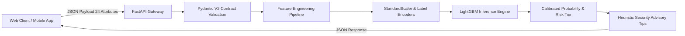

# 🛡️ Sentinel Risk Radar — AI-Powered Credit Card Fraud Detection

[](https://github.com/TechieManya/Pred_creditcard/actions)


A production-ready, full-stack Machine Learning web application and API that evaluates financial transactions in real time to detect fraudulent credit card activity using **LightGBM**, **FastAPI**, and containerized deployment with **Docker**.

---

## 📌 Project Overview

Credit card fraud is characterized by extreme class imbalance, low latency constraints, and evolving attack vectors. **Sentinel Risk Radar** addresses this by providing an end-to-end inference engine with:

- **24 Input Features** capturing transaction velocity, liquidity ratios, geographic anomalies, and digital footprint indicators.
- **Dynamic Server-Side Feature Engineering** deriving 5 interaction and risk features on the fly.
- **Probabilistic Risk Calibration** mapping predictions into 3 actionable risk tiers:
  - 🟢 **LOW RISK (< 30%):** Standard automated clearing.
  - 🟡 **MEDIUM RISK (30% – 70%):** Flagged for manual review or secondary 3DS challenge.
  - 🔴 **HIGH RISK (> 70%):** Immediate decline / account block.
- **Actionable Mitigation Advisory:** Generates context-aware security tips based on active risk triggers (e.g., CVV retries, VPN proxies, address mismatches).

---

## 🏗️ System Architecture



---

## 🔬 Machine Learning Pipeline

### 1. Feature Representation (29 Total Features)
The model takes 24 raw inputs and calculates 5 real-time engineered signals:

| Engineered Feature | Formulation | Domain Rationale |
| :--- | :--- | :--- |
| `total_spending` | amount × txn_count_last_24h | Captures rapid fund drainage bursts |
| `spending_to_balance_ratio` | amount / (account_balance + 1) | Identifies liquidity exhaustion attempts |
| `is_high_risk_hour` | 1 if hour < 6 or hour ≥ 22 | Night-time circadian fraud anomaly |
| `risk_flags_sum` | sum of active boolean risk flags | Cumulative digital footprint risk |
| `cvv_velocity_interaction` | cvv_retries × velocity_score | Bot brute-force credential stuffing |

### 2. Model Training & Evaluation
Trained with **Stratified 5-Fold Cross-Validation** and tracked via **MLflow**:

- **Primary Algorithm:** LightGBM (`LGBMClassifier`)
- **Accuracy:** `92.90%`
- **Precision:** `98.65%`
- **Recall:** `66.53%`
- **F1-Score:** `0.7946`
- **ROC-AUC (Train):** `0.9789`
- **Cross-Validation ROC-AUC:** `0.7585 ± 0.0094`

---

## 📂 Project Directory Structure

```text
Pred_creditcard/
├── .github/workflows/
│   └── ci.yml                     # GitHub Actions CI pipeline
├── model/
│   ├── model.joblib               # Serialized LightGBM model
│   ├── scaler.joblib              # Fitted StandardScaler
│   ├── encoders.joblib            # LabelEncoders for all 12 categories
│   └── feature_cols.joblib        # Exact feature ordering contract
├── static/
│   └── index.html                 # Modern responsive frontend UI
├── tests/
│   ├── conftest.py                # Pytest configuration
│   └── test_app.py                # API test suite (6 comprehensive tests)
├── app.py                         # FastAPI application & endpoints
├── train.py                       # Training pipeline with MLflow tracking
├── verify_app.py                  # Standalone verification script
├── Dockerfile                     # Multi-stage production container
├── requirements.txt               # Full development dependencies
├── requirements-serve.txt         # Minimal lightweight serving requirements
└── README.md                      # Project documentation


🚀 Quickstart & Local Setup
1. Clone the Repository
bash


git clone https://github.com/TechieManya/Pred_creditcard.git
cd Pred_creditcard
2. Create Virtual Environment & Install Dependencies
bash


python -m venv venv
# Windows
venv\Scripts\activate
# macOS / Linux
source venv/bin/activate
pip install -r requirements.txt
3. Run the Application Locally
bash


uvicorn app:app --reload --host 0.0.0.0 --port 8000
Open http://localhost:8000
 in your browser.

🐳 Running with Docker
1. Build the Docker Image
bash


docker build -t fraud-detection:latest .
2. Start the Container
bash


docker run -d -p 8000:8000 --name fraud-api fraud-detection:latest
3. Verify Health
bash


curl http://localhost:8000/health
🧪 Testing
Run the automated test suite with pytest:

bash


pytest tests/ -v
Or run the offline verification script:

bash


python verify_app.py
Test Coverage Summary
test_health: Validates model loading and encoder integrity.
test_ui_loads: Confirms UI availability.
test_domain_logic_high_risk_beats_low_risk: Verifies that anomalous transactions receive higher risk probabilities than baseline transactions.
test_invalid_input_returns_422: Confirms strict Pydantic validation rejects unknown categories with HTTP 422 JSON.
test_out_of_range_numeric_returns_422: Rejects out-of-bounds parameters.
test_prediction_structure: Validates output schema contract.
🌐 API Reference
1. Health Check
http


GET /health
Response:

json


{
  "status": "healthy",
  "model_loaded": true,
  "supported_merchant_categories": [
    "Crypto Exchange", "Electronics", "Fuel", "Gaming", "Gift Cards",
    "Groceries", "Healthcare", "Online Retail", "Restaurants",
    "Streaming", "Travel", "Utilities"
  ]
}
2. Predict Transaction Risk
http


POST /predict
Content-Type: application/json
Sample Request:

json


{
  "amount_usd": 35.00,
  "hours_since_last_txn": 24.0,
  "txn_count_last_24h": 1,
  "distance_from_home_km": 3.5,
  "card_age_months": 36,
  "customer_age": 40,
  "account_balance_usd": 8500.00,
  "cvv_retry_count": 0,
  "velocity_score": 1.0,
  "time_of_day_hour": 12,
  "day_of_week": 2,
  "merchant_risk_score": 15.0,
  "prior_disputes": 0,
  "merchant_category": "Groceries",
  "card_type": "Visa",
  "auth_method": "OTP",
  "channel": "POS",
  "device_type": "iPhone",
  "is_foreign_transaction": false,
  "is_new_merchant": false,
  "used_vpn": false,
  "ip_country_mismatch": false,
  "billing_shipping_mismatch": false,
  "is_ai_generated_scam_attempt": false
}
Sample Response:

json


{
  "fraud_probability": 0.0111,
  "is_fraud": false,
  "risk_level": "LOW",
  "tips": [
    "✅ Low risk transaction. Standard processing recommended."
  ]
}
☁️ Deployment Guide (Render)
Sign in to Render.com
.
Click New + → Web Service.
Connect your GitHub repository: TechieManya/Pred_creditcard.
Configure service settings:
Environment: Python 3
Build Command: pip install -r requirements-serve.txt
Start Command: uvicorn app:app --host 0.0.0.0 --port $PORT
(Alternatively, select Docker as the environment and Render will automatically use your Dockerfile!)
Click Create Web Service. Your app will be live at https://pred-creditcard.onrender.com.
📜 Academic Attribution
Project: Sentinel Risk Radar — Credit Card Fraud Detection Engine
Course: B.Tech Machine Learning / Data Science Project
Author: TechieManya
License: MIT License
